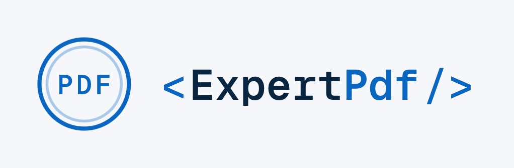

<p align="center">
  <a href="https://www.html-to-pdf.net/">
    
  </a>
</p>

# ExpertPdf engine

The native conversion engines of **ExpertPdf Anywhere** as an HTTP service: the Chromium engine that converts
HTML to PDF and to images, and the PDF tool that extracts text and renders PDF pages to images.

An application normally runs these engines itself, from the `ExpertPdf.Anywhere.Native.<rid>` NuGet package.
With `RenderingEngine.ChromiumRemote` it sends that work to this container instead, which can run on another
machine, as another container, or beside the application in the same pod.

Everything else stays in the application and works as it does with a local engine: building the document,
headers and footers, bookmarks, PDF/A and PDF/UA, security and digital signatures, forms, Word, Excel and
PowerPoint to PDF, redaction - and the license check. **The engine itself needs no license key.**

## Why use it

- **Alpine Linux.** The native engine packages target glibc-based Linux. With the remote engine, an application
  on `mcr.microsoft.com/dotnet/aspnet:10.0-alpine` or another musl-based image converts like any other: this is
  the supported way to use the library there.
- **A small application.** The application references only the managed package (`ExpertPdf.Anywhere`) - no
  native package, no fonts package, no Chromium in its image.
- **Isolation and scale.** Rendering runs apart from the application, scales on its own, and one engine can serve
  several applications.
- **Nothing to install.** The image carries Chromium with every library it needs, fonts for every language (the
  Noto family, color emoji included) and the PDF tool. No `apt-get`, no `--shm-size`, no extra capabilities, no
  display server.

## Tags

| tag | what it is |
|---|---|
| `22.0.0` | the engine for ExpertPdf Anywhere 22.0.0 |
| `22.0` | the latest build for 22.0 |

Each tag is a multi-architecture image for **linux/amd64** and **linux/arm64**; Docker picks the right one.
**Use the tag of the library version your application references.** There is no `latest` tag. When an engine
does not speak the protocol of the library calling it, the conversion fails with a message saying so.

The image is published as `ghcr.io/expertpdf-components/engine` and mirrored on Docker Hub as `expertpdf/engine`. Chromium
154.0.28.

## Quick start

**1. Start the engine** with an access token (at least 32 characters):

```sh
export EXPERTPDF_ENGINE_TOKEN="$(openssl rand -base64 32)"

docker run -d --name expertpdf-engine -p 8080:8080 \
  --read-only --tmpfs /tmp \
  -e EXPERTPDF_ENGINE_TOKEN \
  ghcr.io/expertpdf-components/engine:22.0
```

The engine reports healthy once it has done a first conversion, shortly after it starts:

```sh
curl http://localhost:8080/health
```

**2. Install the managed package** in the application - no native package is needed:

```sh
dotnet add package ExpertPdf.Anywhere
```

**3. Point the application at the engine**, once at startup. The conversion code does not change:

```csharp
using ExpertPdf.Anywhere;
using ExpertPdf.Anywhere.HtmlToPdf;

GlobalSettings.RenderingEngine = RenderingEngine.ChromiumRemote;
GlobalSettings.EngineEndpoint = "http://localhost:8080";
GlobalSettings.EngineAccessToken =
    Environment.GetEnvironmentVariable("EXPERTPDF_ENGINE_TOKEN");

PdfConverter pdfConverter = new PdfConverter();
pdfConverter.SavePdfFromUrlToFile("https://www.example.com", "test.pdf");
```

```vb
Imports ExpertPdf.Anywhere
Imports ExpertPdf.Anywhere.HtmlToPdf

GlobalSettings.RenderingEngine = RenderingEngine.ChromiumRemote
GlobalSettings.EngineEndpoint = "http://localhost:8080"
GlobalSettings.EngineAccessToken =
    Environment.GetEnvironmentVariable("EXPERTPDF_ENGINE_TOKEN")

Dim pdfConverter As New PdfConverter()
pdfConverter.SavePdfFromUrlToFile("https://www.example.com", "test.pdf")
```

Or set the same three values as environment variables of the application, with no code at all - the usual way
in a container deployment:

```
EXPERTPDF_RENDERING_ENGINE=ChromiumRemote
EXPERTPDF_ENGINE_ENDPOINT=http://expertpdf-engine:8080
EXPERTPDF_ENGINE_TOKEN=<one of the engine's tokens>
```

## Application settings

| property (`GlobalSettings`) | environment variable | meaning |
|---|---|---|
| `RenderingEngine` | `EXPERTPDF_RENDERING_ENGINE` | `Chromium` (the default: the engines run in the application) or `ChromiumRemote` (this container). Every converter and HTML element follows it unless its own `RenderingEngine` property is set; the PDF tools always follow it. |
| `EngineEndpoint` | `EXPERTPDF_ENGINE_ENDPOINT` | The engine's url. Default `http://expertpdf-engine:8080` - an engine service named `expertpdf-engine` on the same Docker network or cluster. |
| `EngineAccessToken` | `EXPERTPDF_ENGINE_TOKEN` | One of the tokens the engine was started with. |
| `EngineTimeout` | `EXPERTPDF_ENGINE_TIMEOUT` (seconds) | How long one request may take. By default it follows the conversion's own navigation and print timeouts, plus time to wait for a free slot on a busy engine. |

A single converter can use the remote engine whatever the global setting is, through its own `RenderingEngine`
property (`PdfConverter`, `ImgConverter`, `HtmlToPdfElement`, `HtmlToImageElement`, `HtmlToPdfArea`).

## Engine settings

All settings are environment variables of the container. A setting that cannot be honoured stops the engine at
start, with a message naming it.

| variable | default | meaning |
|---|---|---|
| `EXPERTPDF_ENGINE_TOKEN` | none | The access tokens the engine accepts, separated by commas. Several at once let a token be rotated without downtime: add the new one, move the clients, remove the old one. Each must be at least 32 characters. **Without a token, anyone who can reach the port can use the engine** (it logs a warning). |
| `EXPERTPDF_ENGINE_TOKEN_FILE` | none | A file holding the tokens, one per line - a Docker or Kubernetes secret. Instead of `EXPERTPDF_ENGINE_TOKEN`, not with it. |
| `EXPERTPDF_MAX_CONCURRENCY` | number of CPUs | HTML conversions run at once. |
| `EXPERTPDF_MAX_TOOL_CONCURRENCY` | number of CPUs | PDF to text / PDF to image operations run at once. |
| `EXPERTPDF_QUEUE_TIMEOUT` | `30` | Seconds a request waits for a free slot. After that the engine answers 503 with `Retry-After`, so a retry can reach another replica; the library retries such an answer up to three times. |
| `EXPERTPDF_MAX_BODY_MB` | `100` | The largest request accepted, in MB. |
| `EXPERTPDF_ENGINE_HTTP_CACHE` | `all` | The most of Chromium's HTTP cache a conversion may keep: `clear`, `thirdParty` or `all` (each conversion keeps what it asks for through the converter's `HttpCache` property). **Set `clear` on an engine shared by different callers.** |
| `EXPERTPDF_ENGINE_PORT` | `8080` | The port to listen on - change it when the engine shares a pod with an application on 8080. |
| `EXPERTPDF_TEMP_DIR` | `/tmp/expertpdf-engine` | Where conversions work. Each request has a folder of its own, deleted when it ends. |

A single run is never allowed more than 10 minutes, whatever the client asks for.

## Endpoints

| endpoint | meaning |
|---|---|
| `GET /health` | 200 once the engine has done its first conversion, 503 before that or when it cannot convert. No token needed. The image's `HEALTHCHECK` uses it. `/healthz` answers the same. |
| `GET /v1/info` | The engine's version, Chromium version, platform and limits. Needs the token. |

The conversion endpoints are spoken by the library; there is nothing to call by hand.

## Docker Compose

Name the engine service `expertpdf-engine` and the application needs no endpoint setting at all:

```yaml
services:
  expertpdf-engine:
    image: ghcr.io/expertpdf-components/engine:22.0
    read_only: true
    tmpfs:
      - /tmp
    environment:
      EXPERTPDF_ENGINE_TOKEN: ${EXPERTPDF_ENGINE_TOKEN}
      # an engine shared by different callers:
      # EXPERTPDF_ENGINE_HTTP_CACHE: clear
    mem_limit: 4g

  app:
    build: .
    ports:
      - "8080:8080"
    environment:
      EXPERTPDF_RENDERING_ENGINE: ChromiumRemote
      EXPERTPDF_ENGINE_TOKEN: ${EXPERTPDF_ENGINE_TOKEN}
    depends_on:
      expertpdf-engine:
        condition: service_healthy
```

The engine is not published on the host: only the application can reach it.

## Kubernetes

The engine as a Deployment behind a Service named `expertpdf-engine`, the token from a Secret:

```yaml
apiVersion: v1
kind: Secret
metadata:
  name: expertpdf-engine-token
stringData:
  token: "<at least 32 characters, e.g. openssl rand -base64 32>"
---
apiVersion: apps/v1
kind: Deployment
metadata:
  name: expertpdf-engine
spec:
  replicas: 2
  selector:
    matchLabels: { app: expertpdf-engine }
  template:
    metadata:
      labels: { app: expertpdf-engine }
    spec:
      containers:
        - name: engine
          image: ghcr.io/expertpdf-components/engine:22.0
          ports:
            - containerPort: 8080
          env:
            - name: EXPERTPDF_ENGINE_TOKEN_FILE
              value: /run/secrets/expertpdf/token
          readinessProbe:
            httpGet: { path: /health, port: 8080 }
            periodSeconds: 10
          startupProbe:
            httpGet: { path: /health, port: 8080 }
            periodSeconds: 5
            failureThreshold: 24
          resources:
            requests: { cpu: "2", memory: 2Gi }
            limits: { memory: 4Gi }
          securityContext:
            runAsNonRoot: true
            runAsUser: 1654
            readOnlyRootFilesystem: true
            allowPrivilegeEscalation: false
          volumeMounts:
            - { name: tmp, mountPath: /tmp }
            - { name: token, mountPath: /run/secrets/expertpdf, readOnly: true }
      volumes:
        - name: tmp
          emptyDir: {}
        - name: token
          secret:
            secretName: expertpdf-engine-token
---
apiVersion: v1
kind: Service
metadata:
  name: expertpdf-engine
spec:
  selector: { app: expertpdf-engine }
  ports:
    - port: 8080
      targetPort: 8080
```

The application then sets `EXPERTPDF_RENDERING_ENGINE=ChromiumRemote` and the same token, and needs no endpoint
in the same namespace; from another namespace use
`http://expertpdf-engine.<namespace>.svc.cluster.local:8080`. To run the engine as a second container in the
application's pod instead, give it another `EXPERTPDF_ENGINE_PORT` if the application uses 8080, and set
`EXPERTPDF_ENGINE_ENDPOINT=http://localhost:<port>` in the application.

## In the cloud

| platform | how the application reaches the engine |
|---|---|
| **Azure Container Apps** | the engine as an app with internal ingress named `expertpdf-engine`; the application sets `EXPERTPDF_ENGINE_ENDPOINT=http://expertpdf-engine`. Keep `--min-replicas 1`. |
| **Azure Container Instances** | the engine as a second container in the application's group, `EXPERTPDF_ENGINE_PORT=8081`; the application uses `http://localhost:8081`. Only the application's port is published. |
| **Amazon ECS on Fargate** | the engine as its own service with Service Connect, client alias `expertpdf-engine` on port 8080 (the library's default, no endpoint setting); or as a second container in the application's task on `localhost:8081`, started after the engine is healthy. With `readonlyRootFilesystem`, mount a task volume at `/tmp` - the image declares it, so the volume is writable by the engine. |
| **Google Cloud Run** | the engine as its own service, deployed with `--no-invoker-iam-check`; the application uses its HTTPS URL. Without that flag Cloud Run checks the `Authorization` header of a call from another Cloud Run service as a Google identity token and refuses the engine's token. Check its health from outside at `/health`: Cloud Run reserves paths ending in `z`, so `/healthz` is not served from outside there. |
| **Kubernetes** (AKS, EKS, GKE, ...) | the manifests above; the application uses `http://expertpdf-engine` in the same namespace. |

## Security

- **Use a token, and keep the engine off the public internet** - on the Docker network, the cluster network or a
  private subnet of the application.
- **The token is never sent in clear text to another network.** With a token set, the library requires an
  `https` endpoint unless the endpoint is local: a service name without a dot, `localhost`, a loopback or a
  private address. The engine serves plain HTTP; for an engine on another machine, put TLS in front of it (an
  ingress, a load balancer or a reverse proxy).
- **A page cannot read the engine's files:** local file access is always off in the engine, whatever a conversion
  asks for.
- **The engine fetches what the pages reference, from its own network.** When it converts HTML you do not control,
  limit where the engine's network can reach (internal services, cloud metadata addresses).
- **A shared engine:** set `EXPERTPDF_ENGINE_HTTP_CACHE=clear`, so no conversion is served a response another
  caller's conversion fetched. Cookies and storage are cleared after every conversion in any case.
- **The container runs as a non-root user** (`app`, uid 1654), works with a read-only root file system and a
  writable `/tmp`, and needs no added capabilities.

## What differs from a local engine

- **Local files:** the engine cannot see the application's files, so a `file://` url or base url is refused
  before anything is sent. Convert the HTML as a string, or serve the files over HTTP. Local files an HTML string
  references (images, stylesheets, fonts, media) are sent with it.
- **`localhost`** in a url means the engine's machine, not the application's - except when the engine runs in the
  application's pod.
- **Fonts:** the engine renders with its own fonts (every language). Fonts in the application's own `fonts`
  folder are sent to the engine with each conversion.
- **Per-process settings** of a local engine - WebGL, a proxy, insecure content - are honoured per conversion. A
  proxy must be reachable from the engine.
- **Errors** are the same exception types as with a local engine. When the engine could not be reached or refused
  the request, the message says so and names the request id the engine logs its runs under.
- **Logging:** with `GlobalSettings.LogFile` set, the engine's own log of the conversion is appended to it.
- **Cancellation** of an awaited conversion (`GetPdfBytesFromUrlAsync` and the other asynchronous methods)
  cancels it in the engine.

## Sizing

One engine converts as many pages at once as it has CPUs (by default) and queues the rest. Real pages add the
time it takes to fetch them. For more throughput, run more replicas behind one service rather than one very large
engine. Heavy pages (news sites, long reports) need memory: give each engine 2 GB or more.

## More

- Documentation, Remote Engine topic:
  https://docs.html-to-pdf.net/anywhere-library/html/Remote-Engine.htm
- ExpertPdf Anywhere on NuGet: `ExpertPdf.Anywhere` (the library), `ExpertPdf.Anywhere.Native.<rid>` (the local
  engines, not needed with this image) and `ExpertPdf.Anywhere.Fonts` (fonts for hosts without any)
- Licensing and support: https://www.html-to-pdf.net - office@html-to-pdf.net
- ExpertPdf Anywhere is a product of Outside Software SRL.
